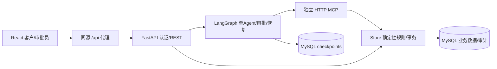
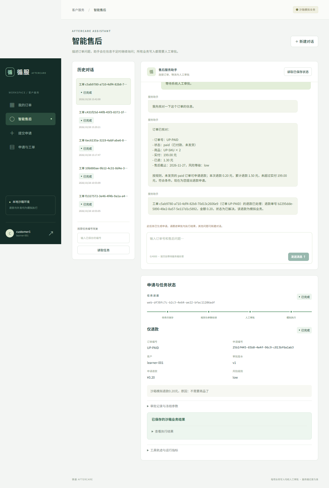
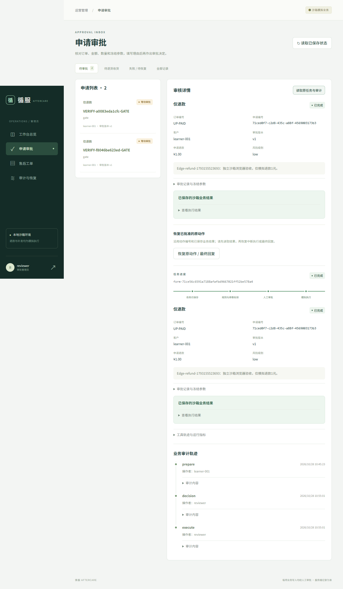

# 电商售后自动化平台（沙箱）

基于既有单 Agent 售后项目升级的 AI 全栈应用：**React + TypeScript + Vite / FastAPI + MySQL / LangGraph + MCP / Docker Compose**。

围绕“客户自然语言诉求 → 查询事实/补问 → 创建申请工单 → 冻结参数审批 → 沙箱执行 → 数据库核验 → 结果与恢复”构建客户服务和审批员双工作台。所有退款、退货、补发均为模拟业务，没有接入真实支付或仓储。

本升级在 `codex/fullstack-upgrade-20261028`，旧main、Streamlit入口及旧实验保留。[历史公开演示](https://yaowcui-ai.github.io/aftersales-agent/demo/) 展示的是此前Streamlit版本；本分支React实际截图和验证记录见下文。

## 产品功能

- 客户：登录、我的订单分页、物流详情、AI聊天与缺参补问、历史任务恢复、表单申请、工单/审批/执行进度。
- 审批员：总览、待批/退货收货/失败筛选、详情、审批理由、批准/拒绝、冻结参数、审计轨迹、原动作恢复。
- 规则：paid直接退款；shipped/delivered先退货授权，管理员收货后才退款；补发校验库存/数量；超期、取消、异常金额拒绝，高风险标记人工复核。
- 工程：MCP独立HTTP进程、服务器身份与动作范围、审批快照摘要、整数分事务、唯一约束、状态重检和幂等恢复。

## 架构与代码



| 路径 | 职责 |
|---|---|
| `frontend/src/` | React客户/管理员、真实HTTP客户端、会话和界面状态 |
| `src/aftersales_delivery/api.py` / `platform_api.py` | 认证、任务/申请、审批/收货/恢复及产品REST |
| `src/aftersales_delivery/agent.py` | 工具循环、interrupt、执行与回复 |
| `business.py` / `policies.py` / `db.py` | 规则、冻结审核、事务和数据模型 |
| `mcp_server.py` / `transport.py` | 独立Streamable HTTP及目的/动作绑定 |
| `tests/platform/` | 新规则、权限、故障、API与评测器测试 |
| `evaluation/upgrade/` | 128条件、分区/版本、原始运行及冻结源码 |

完整设计：[升级审计](docs/UPGRADE_AUDIT.md) · [架构](docs/ARCHITECTURE.md) · [Agent与业务状态](docs/AGENT_WORKFLOW.md)。

## 一键部署

需要 Docker Desktop、可用网络，以及自己的兼容模型配置；本机开发建议Python3.12、uv0.12.5、Node24。

```powershell
# 克隆本分支后，在项目根目录执行
Copy-Item .env.example .env
uv sync --frozen
# 编辑.env：填写自己的模型名、兼容接口地址和密钥
uv run --frozen python scripts/setup_delivery.py --configure-only

docker compose --env-file .env.delivery -f compose.upgrade.yaml up -d --build --wait
```

`.env`示例（均为占位符）：

```dotenv
DEFAULT_MODEL=openai-compatible
COMPATIBLE_MODEL=your-model-name
COMPATIBLE_BASE_URL=https://your-provider.example/v1
COMPATIBLE_API_KEY=your-own-key
USE_FAKE_MODEL=false
```

打开 **[React工作台](http://127.0.0.1:18520)**，API文档 [18100/docs](http://127.0.0.1:18100/docs)，MCP健康 [18101/health](http://127.0.0.1:18101/health)。客户 `customer1/customer2`、审批员 `reviewer` 的随机密码写入本机 `output/delivery/credentials.txt`，不会提交仓库。

Compose使用独立 `aftersales-upgrade` 项目和数据卷，不发布宿主3306，不覆盖旧 `aftersales-delivery` 或项目一。停止使用 `docker compose --env-file .env.delivery -f compose.upgrade.yaml down`，保留数据卷。

当前机器已配置好时，只需打开Docker后执行 `docker compose --env-file .env.delivery -f compose.upgrade.yaml up -d --wait`。修改代码后加 `--build`。

## 前后端本机开发

已有MySQL/模型私有配置时可独立运行API和MCP，设置 `DELIVERY_PLATFORM_ENABLED=1`；依赖本机服务时必须指向独立的项目数据库。更稳妥的开发方式是先运行上述Docker后端，再执行：

```powershell
cd frontend
npm ci
npm run dev
```

Vite默认将 `/api` 代理到本机18100；生产React容器使用同源代理到内部API8090。浏览器不直接访问MySQL，不暴露模型Key。

## 5分钟演示

1. 用customer1登录，查看UP-PAID、UP-SHIPPED及物流。
2. 在智能售后输入“我想退款”，观察缺订单号补问，再提供订单和小额模拟退款诉求。
3. 查看待审批申请及冻结金额；用独立窗口以reviewer登录，填写理由后批准。
4. 回到客户读取原任务，核对实际工单/退款编号；刷新后当前聊天与历史仍可恢复。
5. 对UP-SHIPPED使用“退货退款”：先批准授权，确认当前尚未退款，再由审批员确认收货。
6. 在审计与恢复查看原动作。故障演示脚本会主动停止新MCP并替换API进程，只在专用沙箱运行。

如果演示订单已用过，创建新批次（保留旧订单和财务审计，不清空账本）：

```powershell
docker compose --env-file .env.delivery -f compose.upgrade.yaml exec -T api python scripts/fresh_platform_sandbox.py
```

脚本返回7个新订单编号，包含正常、过期、高风险、取消和另一客户条件。新批次相当于从初态重新演示，避免重置旧余额破坏可追溯性。

## 实际验证与证据边界

| 验证层 | 已保存结果 | 原始记录 |
|---|---|---|
| Python自动化 | 150项通过（含83项旧回归） | [输出](evaluation/upgrade/runtime/python-tests.txt) |
| React单测/生产构建 | 6项HTTP/恢复测试，TypeScript与Vite构建 | [前端](frontend/) |
| 真实MySQL及独立HTTP MCP | 7项事务、并发、归属/审批检查 | [MySQL/MCP](evaluation/upgrade/runtime/mysql-http-mcp.json) |
| 真实Docker进程故障 | 停MCP、审批保存、API替换、同动作恢复/重放 | [运行目录](evaluation/upgrade/runtime/) |
| 生产React真实Agent闭环 | 补问→工具→申请→界面审批→模拟退款→刷新恢复 | [完整轨迹/截图](frontend/evidence/real-agent-chat/) |
| React退货/退款闭环 | 界面批准退款、退货授权、收货后退款 | [轨迹/截图](frontend/evidence/real-browser-flow/) |
| 新结构化业务回归 | 128条件、136run、135通过；不是LLM成功率 | [v2原始记录](evaluation/upgrade/runs/v2-b0-final/) |
| 有限真实模型对照 | 6条件、18模型run、37HTTP；B2 5/6、B3 4/6 | [原始结果](evaluation/upgrade/runs/live-paired-six-frozen/) |
| 历史基线 | 140/144，97.2%，仅对应2026-10-21版本 | [旧记录](evaluation/results/latest.json) |

**保留的失败**：结构化U082错误码与冻结预期不同；真实v1含U045文案/表单冲突，B1是不可公平比较的单次picker，B3另有物流任务未形成申请。v2已修正文案并实现公平手写循环B1，但未重跑真实模型，不用Mock冒充新成功率。真实模型结果尚不足以证明完整图提高决策准确率。

[评测设计](docs/EXPERIMENT_DESIGN.md) · [评测报告](docs/AGENT_EVALUATION_REPORT.md) · [安全报告](docs/SECURITY_TEST_REPORT.md) · [故障报告](docs/FAULT_INJECTION_REPORT.md) · [业务价值](docs/BUSINESS_VALUE.md) · [简历证据](docs/RESUME_EVIDENCE.md)。

## 测试与复算

```powershell
uv run --frozen pytest tests/delivery tests/platform -q
uv run --frozen python tools/verify_evaluation.py
uv run --frozen python scripts/verify_upgrade_evidence.py
uv run --frozen python scripts/evaluate_upgrade.py --catalog-only
uv run --frozen python scripts/evaluate_upgrade.py --all --repeat-core
# 上条保留预期错误码差异，可能返回1；不要修改预期凑全通过
cd frontend
npm test
npm run build
```

真实模型必须显式 `--live`，有运行前预算、案例/源码哈希和逐次结果；默认离线不调用API。Playwright完整本机生产验证用 `python scripts/run_frontend_e2e.py`；`--agent` 明确开启有限真实模型写入验收。GitHub Actions不使用私有密钥，只跑离线测试、报告复算、前端构建和登录布局浏览器测试。

## 实际页面




## 来源和限制

基于Joshua Carroll的MIT项目 [agent-service-toolkit](https://github.com/JoshuaC215/agent-service-toolkit)，固定学习基线`58f6a059f9787db1a68946030b35dd61023662fa`，保留 [LICENSE](LICENSE) 和 [上游说明](docs/upstream-toolkit.md)。采用AI辅助实施，不声称从零独立编写全部框架。

本机单API worker、配置账户和沙箱业务，没有真实企业部署、SSO、资金或仓储连接，没有真人工时研究。不将旧97.2%或确定性Mock回归冒充升级版真实模型效果。
