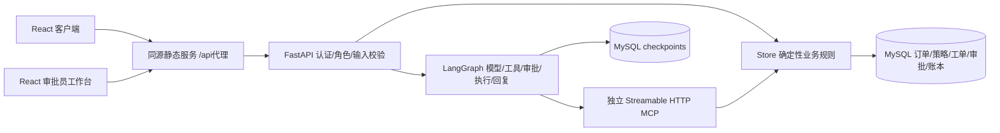

# AI 全栈售后沙箱架构

基线 `5563140`，升级位于 `codex/fullstack-upgrade-20261028`。复用原包、模型工厂、LangGraph、MCP、MySQL事务，不把历史实现替换成另一套项目。原 Streamlit 与 `compose.delivery.yaml` 保留。

## 职责与安全边界

| 层 | 职责 | 不能承担的职责 |
|---|---|---|
| React + TypeScript + Vite | 登录、订单/物流、聊天与补问、申请、历史、审核、审计和告警 | 不计算最终授权，不直接连接数据库 |
| FastAPI | 验证目的绑定令牌、配置账户角色和归属，提供稳定REST与错误码 | 不相信请求中的客户身份或“已批准”文本 |
| LangGraph | 有限模型循环、interrupt、检查点和恢复路由 | 不自行批准，不绕过Store执行 |
| 独立MCP | 短期签名上下文注入客户/动作、工具白名单 | 普通session token不能作为MCP凭据；普通读token不能执行动作 |
| Store/策略 | 期限、状态、金额、库存、冻结参数校验，事务与幂等 | 不把模型答复作为账本结果 |

## 数据模型

保留 `orders/inventory/shipments/actions/cases/refunds/reships/events`。新增 sidecar：

- `order_policies`：售后期限、风险等级、人工复核金额阈值。只对有策略的订单启用新规则；旧demo规则不篡改。
- `user_profiles`：非敏感用户资料；本机演示凭据仍通过私有配置提供，未接企业SSO。
- `tickets`：申请时就在事务内建立业务工单，状态与执行case分别记录。
- `approval_reviews`：对象、版本、决定、审批人、时间、理由、冻结快照和SHA256摘要。
- `task_index`：客户与thread的哈希主键、状态、最后输入/答复和错误码；用于导航，不能替代checkpoint。

客户身份保留精确值，避免大小写或末尾空格归一化扩大权限。金额采用整数分，输出转换为元字符串；库存和退款累计值由条件更新与约束维护。动作、退款/补发记录具有唯一业务约束。

## 状态与一致性

`ticket.status` 描述工单处理，`action.status` 描述业务执行，图状态描述任务推进。API分别返回，禁止把“执行完成”冒充“物流问题已解决”。提交业务后丢响应时，读取原动作；业务已完成但checkpoint落后时返回恢复提示，恢复原回复节点。取消后即使checkpoint写失败，也以数据库取消事实生成明确通知。

## 部署

升级Compose项目为 `aftersales-upgrade`，独立 `platform_mysql` 卷，不映射宿主3306。React18520、API18100、MCP18101；单API worker，本机演示账户。未接真实支付/仓储，非公网生产部署。数据库初始化只追加缺失记录，不覆盖旧数据。无冻结审计的历史已批准动作安全拒绝，不自动伪造旧审批快照。

交付另从默认 `python:3.12-slim` 构建干净后端镜像，实际安装锁定依赖；使用 `--network none` 导入API/MCP，证明不依赖原有预装项目镜像才能安装。初次构建需要下载上游完整依赖，耗时与网络有关；原始构建输出及镜像ID见 `evaluation/upgrade/runtime/clean-image-*`。该导入检查与运行容器上的真实业务/浏览器验收分开记录。
