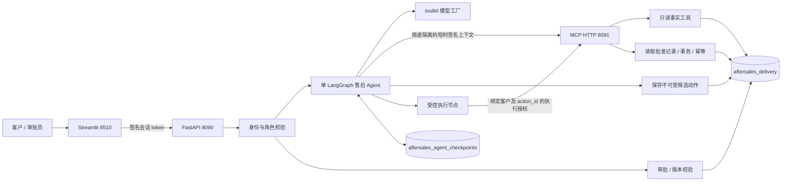
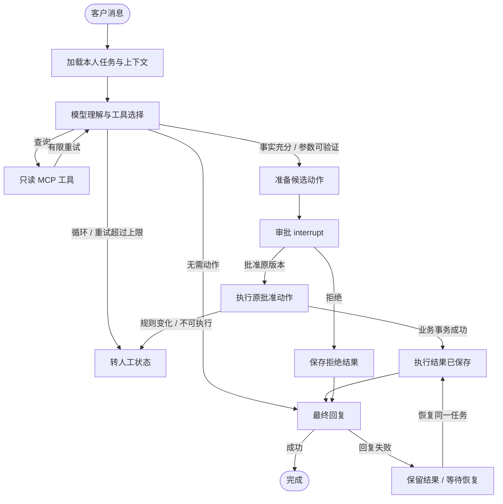
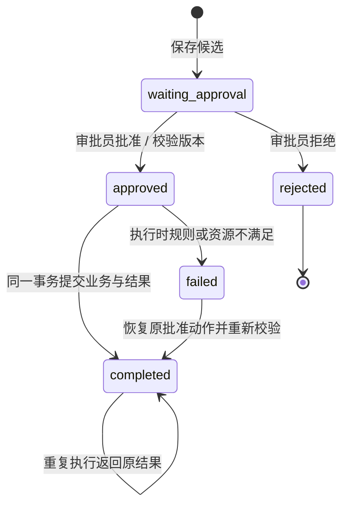

# 架构、状态与恢复

交付版将「模型理解与建议」和「业务执行权限」分开：模型读取事实、生成候选；审批员确认具体不可变动作；数据库事务决定是否执行。所有订单、退款、补发与库存均为演示数据。

本机复用原项目的模型访问配置和 MySQL 连接，不改变原业务库。新增业务库只包含 `orders`、`shipments`、`inventory`、`actions`、`cases`、`refunds`、`reships`、`events` 等交付表。checkpoint 数据库保存图状态与中断位置；交付业务事务记录保存最终执行事实，二者职责不同。Docker 内是独立 MySQL 容器与命名卷，同名数据库不会指向本机实例。

## 图执行与权限边界

工具白名单包括 `get_order`、`get_shipments`、`get_inventory`、`get_case` 和受控 `execute_action`。查询工具从服务端可信上下文获取客户身份；执行工具必须使用针对已批准动作签发的授权。模型输出的金额、数量和客户标识不能替代数据库审批记录。执行服务读取原记录，执行时再次验证订单、退款额度和库存。

每个客户任务最多对应一个不可变候选动作，客户/任务唯一约束防止重复准备；动作、退款、补发、工单之间的唯一约束防止同一动作重复落库。事务中的行锁和条件更新处理并发退款、库存竞争；SQLite 测试和 MySQL 运行需要分别验证，不能以 SQLite 行为替代 MySQL 并发验收。

## 三类状态分别保存

| 状态对象 | 典型状态 | 表达的事实 |
| --- | --- | --- |
| 图任务 | 运行、待审批、完成、回复失败、需人工 | Agent 当前停在哪里、下一步是什么 |
| 业务动作 | `waiting_approval`、`approved`、`rejected`、`completed`、`failed` | 具体候选是否批准、是否已执行 |
| 售后工单 | `open`、`processing`、`resolved`、`closed` | 审批执行后的人工业务处理进展 |

批准和拒绝针对展示给审批员的 `action_id + version`。参数改变应产生明确冲突，不能悄悄执行另一金额。审批结果持久化后才恢复图。用户刷新页面时从 API 和数据库重读状态，不依靠 Streamlit 当前内存推断结果。

若业务已提交、HTTP 响应丢失，重试读到已完成动作并返回原结果；若业务已成功、最终模型回复失败，任务显示结果已保存和回复失败，恢复不会再退款或再扣库存。checkpoint 保存失败也不能撤销已提交业务事实；应先按动作结果核对，再恢复图。

## 模型、审计与评测

模型通过原框架工厂构造，供应商及 `DEFAULT_MODEL` 取自项目配置。真实消息、工具调用/返回、模型调用数、耗时和模型返回的 Token 统计留在任务记录中。动作事件记录审批、执行与状态处理信息，可用于核对「谁批准了什么」以及是否重复执行。

固定评测与故障验收分开：规则测试验证可重复的权限、金额、库存、审批和幂等不变量；真实模型评测验证需求理解、工具选择和端到端结果。无恢复基线用于对照断连与重复请求下的表现。48 案例的开发/保留划分在运行前固定，实际完成次数、失败与缺失统计都应保留。

## 来源和部署边界

复用框架为 MIT 授权的 Joshua Carroll `agent-service-toolkit`，基线提交 `58f6a059f9787db1a68946030b35dd61023662fa`。原代码保留；新增交付模块及脚本说明见根目录 `README_DELIVERY.md`。当前按单 API worker 部署，审批与执行仍有数据库约束；多 worker/多实例的 checkpoint 调度不在演示交付的验证范围内。

此场景的事实源是结构化订单与工单数据库，单 Agent 加工具和审批即可完成闭环。RAG、多 Agent、真实支付和仓库对接均没有作为本次实现前提。将项目用于生产前，应按实际售后政策补充外部交易幂等、对账、账户管理、密钥保护及部署监控。
